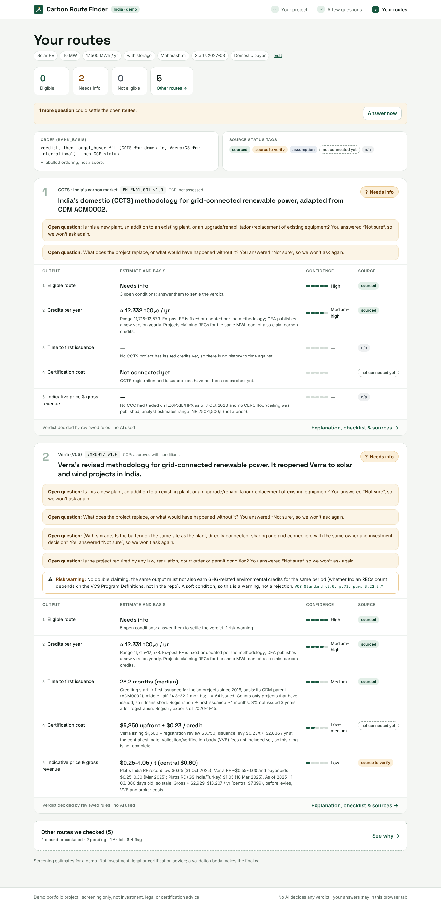
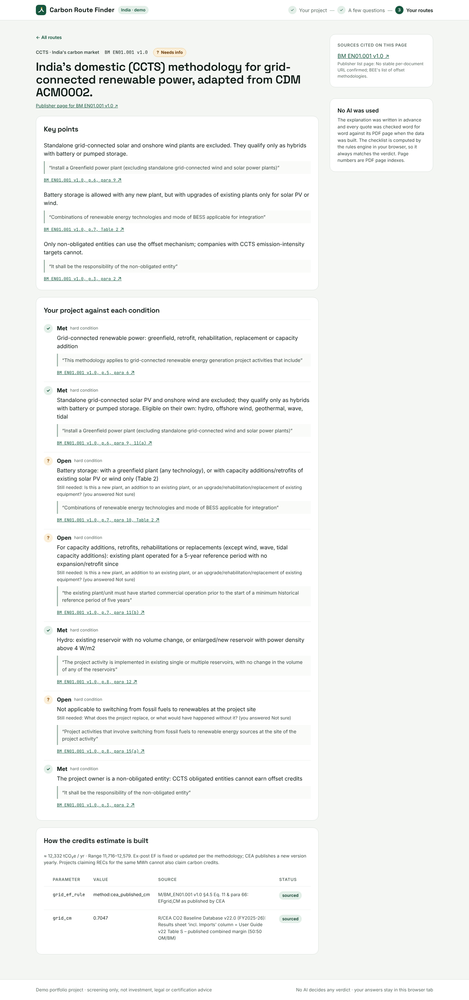

# Carbon Route Finder (India · demo)

**Live site: https://adityas5.github.io/carbon-credit-portal/**

Carbon Route Finder helps an Indian project developer find out which carbon-credit routes their project can use.
It covers **Verra (VCS)**, **Gold Standard** and **CCTS** (India's domestic carbon market), and flags **Article 6.4 (PACM)**
where it applies. For each route it shows estimated credits, time to first issuance, certification cost and an
indicative price, each with a confidence level and a source.

It is a portfolio demo, not advice. It runs entirely in your browser: no account, no API key, no backend. Your
answers never leave the page.



## What it does

1. **Intake (about 12 questions):** sector, technology, state, size, start date, what the project replaces, and a few
   yes/no facts. "Not sure" is always allowed and is never treated as "no".
2. **Screening:** every methodology in the sector goes through a hard filter (India route open, not inactive,
   CCTS-obligated entities excluded, start-date rule). PACM rows are flagged only, and pending rows go to a watchlist.
3. **Conditions:** each remaining methodology's applicability conditions are evaluated against your answers.
4. **Questionnaire:** conditions that are still open become questions. They are deduplicated across standards and
   ranked by how many routes they decide, with at most 6 per round and up to 3 rounds. No question is asked twice.
5. **Results:** routes ranked by verdict, then buyer fit, then ICVCM CCP status. Each route gets an output ladder, a
   checklist of every condition with a citation, and a pre-written explanation.

| Rung | Output | Confidence |
|---|---|---|
| 1 | Eligible route (standard + methodology) | high |
| 2 | Credits per year (CEA v22 grid factors; IPCC / CDM defaults elsewhere) | medium–high to low, by sector |
| 3 | Time to first issuance (from Verra / Gold Standard registry exports) | medium |
| 4 | Certification cost (published registry fees) | low–medium |
| 5 | Indicative price band (sourced and dated) | low |

Where there is no data, the site says "not connected yet" or "n/a" rather than showing a placeholder number. Every
value carries a status tag: *sourced*, *source to verify*, *assumption*, *not connected yet* or *n/a*.

## Verdicts are decided by code, not AI

- Conditions were extracted from the methodology and eligibility PDFs. During that offline build, every quote was
  matched word for word against its PDF page; a mismatched quote fails the build.
- Every condition on an open route is a **reviewed rule**: data in `data/conditions.json`, using 14 operators and
  nested `any_of` / `all_of` with three-valued logic.
- The overall verdict is fixed logic: any hard condition not met → **not eligible**; otherwise any open condition →
  **needs info**; otherwise **eligible**. A soft condition that fails becomes a risk warning, never a rejection.
- Where a coded rule is stricter than the methodology (an exception isn't modelled), a failure returns
  **"check with an expert"**, not "not eligible".
- Explanations are pre-written and quote-checked. The public site uses no LLM.



## Evaluation results

| Check | Result |
|---|---|
| Eval set | 23 Indian project profiles across all 5 sectors (grid RE 5, landfill gas 5, biogas 4, A/R 4, industrial EE / fuel switch 5) |
| Expected outcomes | Derived from the PDFs (page and paragraph cited), not from the coded rules |
| Python reference engine | **23 / 23** profiles match the expected outcome for every route in the sector |
| This TypeScript engine vs Python | **23 / 23** cases identical (every question round, condition verdict, reason, route order and explanation), plus **3,204 / 3,204** calculator calls |
| Questionnaire length | Mean 3.5 questions per profile; max 12 (two large biogas farms), at most 2 rounds |
| Conditions | 139 conditions, every one on an open route a reviewed rule; 20 routes open to new Indian projects |

The parity check runs in CI in the private repo on every change. New engine code or data is synced here only after it
passes.

## What's in this repo, and what isn't

| Here (public) | Private repo |
|---|---|
| Next.js site (`app/`, `components/`, `lib/`) | Methodology and eligibility PDFs |
| `engine-ts/`: TypeScript engine + calculators (synced, read-only) | Registry exports (Verra, Gold Standard, CEA) |
| `data/`: derived JSON (registry, conditions with short cited quotes, explanations, sources, vocabulary, calculator data, issuance statistics) | Python extraction pipeline, Python reference engine, evals, BM25 index |

The source documents and the Python pipeline are kept private, so they are not republished. Every citation on the site
links to the publisher's page for that document instead (`data/sources.json`). Page numbers are 1-based PDF page
indexes.

`engine-ts/` and `data/` are overwritten by a one-way GitHub Action in the private repo. Don't edit them here.

## Run it locally

```bash
npm ci
npm test          # smoke test: one profile per sector through engine + output ladder
BASE_PATH= npm run dev   # http://localhost:3000
npm run build     # static export to out/ (basePath /carbon-credit-portal)
```

Requires Node 22.18 or later. Deployment: `.github/workflows/pages.yml` builds the static export and publishes it to
GitHub Pages on every push to `main`.

## Scope and limits

- v1 sectors: grid-connected renewables, landfill gas, biogas / manure, afforestation / reforestation (including
  mangroves under CCTS), industrial energy efficiency / fuel switch.
- Additionality tests (investment analysis, common practice) are obligations the tool does not screen. A project that
  is profitable without carbon revenue may still fail them.
- "I don't have a project yet" (explore mode) is coming next. Its land and budget conversion data is still being
  checked against sources.
- Screening only: a validation/verification body makes the final call. Not investment, legal or certification advice.
